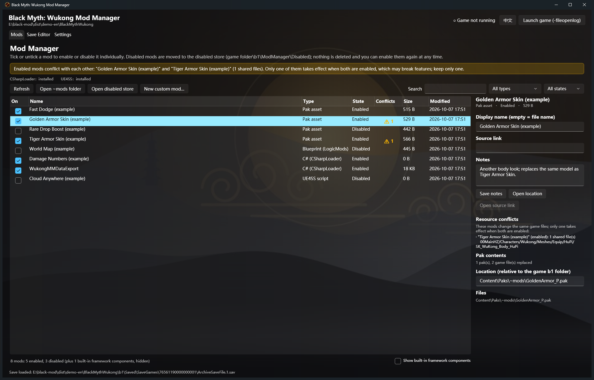
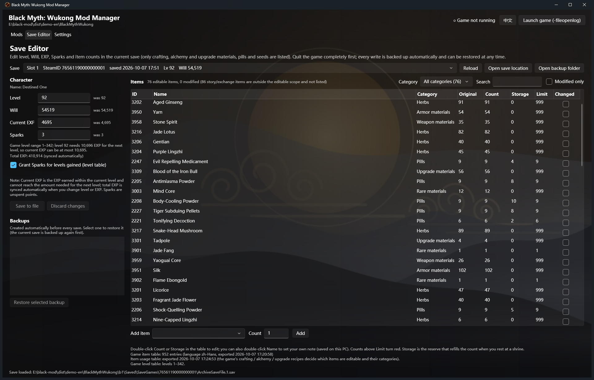
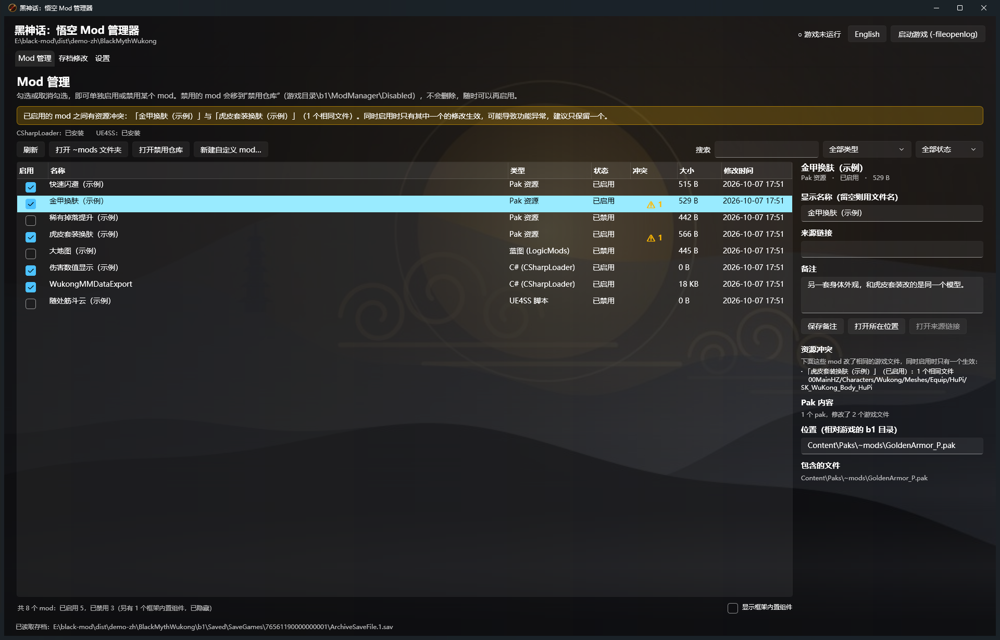
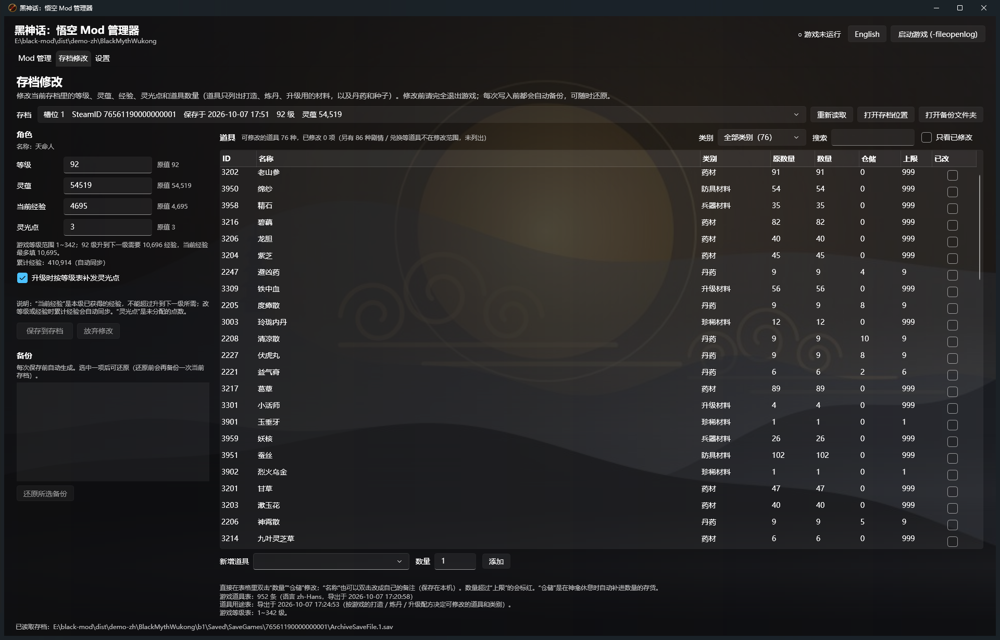

# WukongMM — Black Myth: Wukong Mod Manager & Save Editor

[中文说明](#中文说明) · [English](#english)

A Windows desktop tool for **Black Myth: Wukong** (Steam, PC) that
1. turns installed mods **on and off one by one** (pak / LogicMods / CSharpLoader / UE4SS / custom groups) and warns about pak mods that **replace the same game files**, and
2. edits the **current save offline**: level, Will, EXP, Sparks and the counts of crafting / alchemy / upgrade materials, pills and seeds — following the game's own rules, with automatic backups.

The interface is available in **Chinese and English** (button at the top right). Mod names and notes stay as their authors wrote them.

> Not affiliated with or endorsed by Game Science. "Black Myth: Wukong" is a trademark of its owner. Editing saves always carries risk — keep the automatic backups.




---

## English

### Features
**Mod manager**
- Finds the game automatically (Steam library scan) or lets you pick the folder.
- Detects pak mods (`b1\Content\Paks\~mods`, loose paks without `.sig`), blueprint mods (`LogicMods`), CSharpLoader mods, UE4SS script mods, and lets you group any files into a **custom mod** (for mods spread over several folders).
- Each mod has its own switch. Disabling moves the files into `b1\ModManager\Disabled` (same relative path) — nothing is deleted; enabling moves them back. Moves are transactional and refused while the game runs.
- **Resource conflict detection**: reads the index of every mod pak (no extraction) and lists mods that replace the same game files. You get a warning before enabling a mod that conflicts with an enabled one.
- Notes, display names and source links per mod; framework checks (CSharpLoader / UE4SS); "Launch with `-fileopenlog`" button.

**Save editor**
- Level, Will, current EXP (total EXP is kept in sync), Sparks — validated against the game's level table (no levels the game does not know, EXP within the level limit, optional Sparks for gained levels).
- Items: only **crafting, alchemy and upgrade materials, pills and seeds** are listed (89 items in game 1.0.21), split into categories (Pills, Herbs, Seeds, Weapon materials, Armor materials, Rare materials, Upgrade materials) with a category filter. Story/quest items and exchange-only items are never shown or changed.
- Before writing: game-running check, file-changed check, self-check, **automatic backup**, recalculated save checksum. One-click restore of any backup.

### Requirements
- Windows 10/11 x64 and the [.NET 10 Desktop Runtime](https://dotnet.microsoft.com/download/dotnet/10.0) (x64).
- Black Myth: Wukong, Steam PC version (tested with 1.0.21, build 21393610).
- For item names / categories in the save editor: [CSharpLoader](https://github.com/czastack/B1CSharpLoader) plus the bundled **WukongMMDataExport** mod (installed from the Settings page).

### Getting started
1. Download `WukongMM-<version>-win-x64.zip` from [Releases](https://github.com/aloneGtz/WukongMM/releases/latest) (new versions are published here only), extract it anywhere and run `WukongMM.exe`.
2. The game folder is detected automatically (otherwise: Settings → Game folder).
3. Optional but recommended: install CSharpLoader, then Settings → **Install / update the export mod**, start the game and load a save once. For English item names, switch the game's text language to English and load a save once more.
4. Quit the game before toggling mods or writing a save.

See the [user guide](docs/USER_GUIDE.en.md) for details.

### Recommended mods (download from their authors)
WukongMM does not redistribute anyone's mods. Popular ones that work with it:
| Mod | Type | Link |
|---|---|---|
| CSharpLoader (framework) | — | https://github.com/czastack/B1CSharpLoader |
| UE4SS for Black Myth (framework) | — | https://www.nexusmods.com/blackmythwukong/mods/19 |
| Effect Detail Description (shows exact numbers) | C# | https://github.com/xyzkljl1/MyBlackMythWukongMods |
| Simple Map | LogicMods | https://www.nexusmods.com/blackmythwukong/mods/60 |
| Somersault Cloud Anywhere | UE4SS + pak | https://www.nexusmods.com/blackmythwukong/mods/92 |
| Better dodge | pak | https://www.nexusmods.com/blackmythwukong/mods/55 |
| Increased Rare Item Drop Rates | pak | https://www.nexusmods.com/blackmythwukong/mods/405 |
| BossRushV3 | C# | https://www.nexusmods.com/blackmythwukong/mods/668 |
| Stronger JinguBang | pak | https://www.nexusmods.com/blackmythwukong/mods/291 |
| TrueDasheng | UE4SS + pak | https://www.nexusmods.com/blackmythwukong/mods/426 |

Mods spread over two folders (UE4SS script + pak) are best added as one **custom mod** so they are switched together.

### Building from source
```
dotnet build WukongMM.slnx -c Release
dotnet publish src/WukongMM.App -c Release -r win-x64 --self-contained false -p:PublishSingleFile=true -p:PublicArt=true
```
- `src/WukongMM.Core` — save format (lossless protobuf, XOR, checksum), game rules, mod scanning/toggling, pak index reader.
- `src/WukongMM.App` — WPF UI (Fluent dark theme). `src/WukongMM.Cli` — `wmm.exe`, command line + `wmm selftest` unit tests.
- `mods/WukongMMDataExport` — the in-game export mod (net472); building it needs the game's managed assemblies, see its README.
- Technical notes: [docs/SAVE_FORMAT.md](docs/SAVE_FORMAT.md), [docs/MOD_LAYOUT.md](docs/MOD_LAYOUT.md), [docs/ARCHITECTURE.md](docs/ARCHITECTURE.md) (in Chinese).

### License
MIT — see [LICENSE](LICENSE). Background image and icon in this repository are original works generated by `tools/art/make-art.cs`.

---

## 中文说明

《黑神话：悟空》（Steam PC 版）的 Windows 桌面工具：
1. **逐个启用 / 禁用**已安装的 mod（Pak / 蓝图 LogicMods / CSharpLoader / UE4SS / 自定义分组），并检查**改了相同游戏文件**的 pak mod（资源冲突）；
2. **离线修改当前存档**：等级、灵蕴、经验、灵光点，以及打造 / 炼丹 / 升级材料、丹药、种子的数量——按游戏自己的规则校验，写入前自动备份。

界面支持**中文 / English**（右上角按钮切换），mod 的名称和备注保持作者原文。

> 本工具与游戏科学无关。修改存档有风险，请保留自动备份。




### 功能
**Mod 管理**
- 自动查找游戏目录（扫描 Steam 库），也可手动指定。
- 识别 `~mods` 里的 pak、Paks 根目录无签名的 pak、`LogicMods` 蓝图 mod、CSharpLoader mod、UE4SS 脚本 mod；分散在多处的 mod 可组合成一个**自定义 mod** 一起开关。
- 每个 mod 单独开关：禁用 = 移到 `b1\ModManager\Disabled`（保留相对路径），不删除任何文件；失败自动回滚；游戏运行时禁止操作。
- **资源冲突检测**：只读每个 pak 的索引（不解压），列出改了相同游戏文件的 mod；启用会和已启用 mod 冲突的 mod 前会提醒。
- 显示名 / 来源链接 / 备注；框架检测；"带 -fileopenlog 启动游戏"按钮。

**存档修改**
- 等级、灵蕴、当前经验（累计经验自动同步）、灵光点，按游戏等级表校验（等级必须在表内、经验不超过本级上限、可选补发升级灵光点）。
- 道具只列出**打造、炼丹、升级用的材料，以及丹药和种子**（游戏 1.0.21 共 89 种），细分为丹药、药材、种子、兵器材料、防具材料、珍稀材料、升级材料，可按类别筛选；剧情 / 任务道具、只用于兑换的道具（如佛手）不显示、不修改。
- 写入前检查游戏未运行、文件未被改动、自检，**自动备份**并按游戏算法重算校验值；任意备份一键还原。

### 使用
1. 从 [Releases](https://github.com/aloneGtz/WukongMM/releases/latest) 下载 `WukongMM-<版本>-win-x64.zip`（新版本只在这里发布），解压后运行 `WukongMM.exe`（需要 [.NET 10 桌面运行时](https://dotnet.microsoft.com/download/dotnet/10.0) x64）。
2. 自动找到游戏目录（找不到时到"设置"页指定）。
3. 建议：先安装 [CSharpLoader](https://github.com/czastack/B1CSharpLoader)，再到"设置"页点**安装 / 更新导出 mod**，进一次游戏读档；想要英文道具名，把游戏文字语言切成英文再读一次档。
4. 启停 mod、写存档前请先退出游戏。

详细说明见[用户手册](docs/USER_GUIDE.md)。推荐 mod 见上方英文部分的表格（请从原作者处下载，本工具不转载任何 mod）。

### 许可证
MIT，见 [LICENSE](LICENSE)。仓库里的背景图和图标是 `tools/art/make-art.cs` 生成的原创素材。
